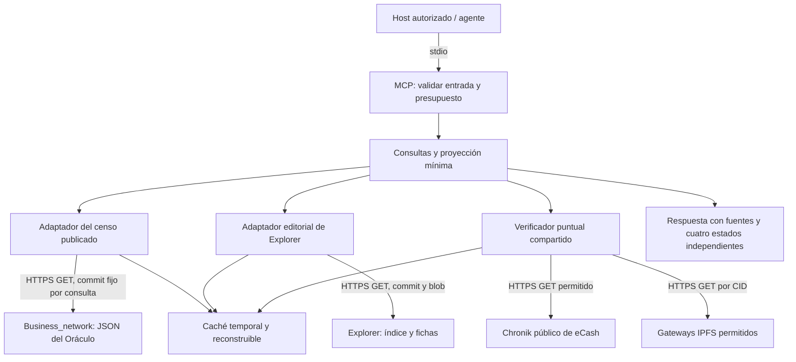

# Arquitectura propuesta

## Autoridad y alcance

El servidor consulta un snapshot publicado por el Oráculo y adjunta observaciones
de Chronik/IPFS bajo demanda. Una discrepancia produce evidencia y un estado de
conflicto; nunca una reparación automática. Tampoco reconstruye un censo mediante
escaneo de la cadena, deduce parentesco por nombres, ni agrega fichas de Explorer
al censo. Una ficha editorial fuera del censo puede recuperarse como tal, con
`membership=editorial_only`, sin alterar totales o pertenencia.

El MVP no contiene wallets, llaves privadas, secretos de firma, RPC de nodo,
firma, minteo, broadcast, pinning, escritura remota ni conexiones a redes internas.
Un token de lectura de GitHub, si fuese necesario por cuota, es una credencial de
consulta, no una llave privada; no se transmite a Chronik o IPFS. Las fuentes
públicas deben funcionar sin credenciales de los publicadores.



El Oráculo actual conserva su propio estado y publica el censo mediante su
pipeline existente. Ese proceso está fuera del servidor MCP y no se invoca al
consultar. Las únicas escrituras locales del MCP serán caché temporal opcional y
logs mínimos; ningún dominio de datos será editable.

## Componentes y flujo

1. **Transporte:** stdio en un proceso iniciado por el host autorizado, sin puerto
   de escucha. `stdout` queda reservado al protocolo y los logs van a `stderr`.
   La autorización corresponde al usuario del sistema y a la configuración de
   herramientas del host; no se acepta identidad o scope dentro de argumentos.
2. **Validación:** esquemas cerrados, cinco nombres de herramienta, identificadores
   explícitos, límites de consultas y rechazo de campos adicionales. No hay
   herramienta de fetch libre, shell, ficheros o consultas de direcciones.
3. **Snapshot del Oráculo:** resolver una vez `Business_network/main` a un SHA;
   obtener `lineages.json`, `metrics.json` y, para comprobar coherencia,
   `recent-registrations.json` de ese mismo SHA. Validar bytes/blobs, esquema e
   invariantes con el componente existente. No mezclar lecturas de `main`.
4. **Explorer:** usar la procedencia de cada registro del censo para recuperar su
   ficha en ese commit, si existe. Para consultas editoriales independientes,
   resolver el HEAD una vez y declararlo como snapshot separado. Parsear datos
   estáticos sin ejecutar JavaScript remoto; no importar `App.jsx` ni hacer
   scraping del HTML. Si cambia la sintaxis, detener el adaptador con
   `SOURCE_SCHEMA_UNSUPPORTED`; no usar expresiones regulares como parser del MVP.
5. **Resolución:** txid/tokenId es la identidad técnica. Slug es un alias de
   presentación, Unicode NFC, trim y minúsculas, sin transliterar silenciosamente
   `ñ` ni eliminar acentos de una clave existente. Mantener candidatos por fuente.
   Más de un candidato o desacuerdo entre fuentes produce `AMBIGUOUS_ID` o
   `SOURCE_CONFLICT`. No elegir el primero ni hacer coincidencias aproximadas.
6. **Verificación:** consultar exclusivamente la transacción identificada, su token,
   bloque y punta. Validar red mediante el ancla existente y pertenencia de bloque
   a la cadena observada; aplicar las reglas compartidas del Oráculo. Recuperar
   solo el CID de la génesis corroborada y comprobar SHA-256 de los bytes exactos
   contra `documentHash` antes de interpretar JSON. No descargar imágenes, videos
   o vínculos secundarios. No intentar búsquedas históricas amplias.
7. **Salida:** proyección de campos permitidos, evidencia por campo, cuatro estados
   de confianza y separación entre afirmaciones publicadas y observaciones nuevas.
   No hay un booleano global `verified` ni una puntuación de confianza agregada.

Los fallos de origen no se convierten en censo vacío o en contadores cero.
Un resultado parcial requiere al menos la identidad/snapshot de la fuente primaria;
si falta, se devuelve un error de herramienta. `get_census` no fabrica métricas
con datos de Chronik ni con fichas editoriales.

## Reutilización segura

| Componente existente | Decisión propuesta | Condición / límite |
| --- | --- | --- |
| Oráculo `protocol.mjs`: `ID`, `GROUPS`, `readPushes`, `parseCid`, `decodeGenesis` | Extraer/exportar desde la fuente existente como biblioteca de lectura | Mantener una sola implementación y sus pruebas; acotar tamaños y errores; validar también la respuesta Chronik |
| Oráculo `ipfs.mjs`: `probe`, lectura acotada y hash de bytes | Reutilizar núcleo mediante cliente de red inyectado | Envolver con política SSRF, plazos y cuotas MCP; no reutilizar scheduler/caché persistente del indexador |
| Oráculo `genealogy.mjs` y reglas de `census.mjs` | Reutilizar comprobaciones de integridad y procedencia | Validar snapshot publicado; no ejecutar `buildCensus` para construir una publicación alternativa |
| Oráculo `chronik.mjs` | Reutilizar criterios y SDK, separar cliente de lectura puntual | No importar el cliente sin adaptar: admite un endpoint privado y modifica defaults globales de Axios; no ejecutar `scan` |
| Oráculo `run.mjs`, `publish.mjs`, `cli.mjs` | Excluidos del grafo de dependencias del MCP | Contienen estado operativo, procesos Git y publicación; una importación no debe alcanzar esos módulos |
| Explorer `linajeIndex.js`, `linajeMeta.js` | Consumir como datos versionados | Parser AST estático con literal permitido o exportación de solo lectura desde Explorer; nunca `eval`, import remoto ni copia mantenida del catálogo |
| Explorer `ipfsMetadata.js` | Reutilizar convenciones de URL y nombres de campo donde sean compatibles | No reutilizar fetch sin endurecerlo: acepta HTTP(S) arbitrario y caché sin caducidad; el hash de texto re-encodeado no sustituye el hash de bytes |
| Explorer `App.jsx` | Referencia para enlaces y presentación | Su prioridad `local > ipfs > onchain` es editorial; su decodificador ASCII y resolución por nombres no sirven como prueba |
| Business `js/census.mjs` | Reutilizar significado de contadores, nulos y presentación | Su fallback legado `hasParents` y sus etiquetas no son política de verificación del MCP |

La extracción propuesta se revisará primero en `xolo-oracle-indexer` y, cuando
proceda, en Explorer. Debe tener API, licencia explícita, tag/commit y dependencias
fijadas con integridad. No se encontró `LICENSE` en el árbol local revisado del
Oráculo: aprobar su licencia es una condición previa a distribuir código suyo.
Si no puede compartirse una función con seguridad, documentar el motivo y adaptar
el componente en su repositorio propietario; no mantener dos reglas divergentes.
Las fixtures de pruebas del MCP serán sintéticas, pequeñas y sin autoridad censal.

## Caché, coherencia y frescura

- Caché de memoria por defecto, máximo 32 MiB. Snapshot del censo y commit editorial:
  TTL de resolución HEAD 5 minutos; los bytes se identifican por repositorio/SHA/blob.
  Retener snapshots solo durante 15 minutos para paginación; después, `CURSOR_EXPIRED`.
- Ningún trabajo de indexación, base maestra, edición, migración, reconciliación
  persistente o exportación automática del censo. Descartar la caché no cambia la
  identidad ni el contenido de las fuentes. No reusar el estado privado del Oráculo.
- Observaciones Chronik: TTL 30 segundos, ligadas a tipHash y blockHash. Observaciones
  IPFS: TTL 5 minutos, clave CID + documentHash + versión de verificador. Fallos
  temporales: 30 segundos como mínimo, respetando `Retry-After` y cooldown del gateway.
- Pasado el TTL no se sirve una verificación como actual. Si el origen falla, se
  permite el último snapshot con `freshness=stale` y edad explícita, máximo 24 horas
  desde la lectura exitosa; si no existe, `UPSTREAM_UNAVAILABLE`. Los datos obsoletos
  no pueden producir un estado nuevo de verificación.
- `ultima_actualizacion` fecha la versión del contenido del Oráculo. Una consulta
  exitosa solo cambia `retrieved_at`; no prueba que el timer haya corrido. Exponer
  `publisher_health=unknown` mientras no exista evidencia pública de chequeo vivo.
  No usar el umbral visual de 48 horas del portal como prueba de caída del pipeline.

Cursores opacos de 128 bits, aleatorios y ligados a sesión, herramienta, filtros,
SHA y posición. No necesitan secretos de firma; almacenarlos temporalmente en
memoria. Una consulta no admite SHA/URL arbitrarios del usuario: `snapshot_id`
solo selecciona uno ya emitido a la misma sesión y aún retenido.

## Presupuestos iniciales para revisión

| Recurso | Límite MVP |
| --- | --- |
| Página | 20 registros por defecto; máximo 50 |
| Snapshot | 10 MiB por JSON; 25 MiB total; 10 000 filas |
| IPFS | 256 KiB de bytes descomprimidos, UTF-8 estricto, JSON objeto; profundidad 16 y 2 000 claves |
| Chronik | 2 MiB por respuesta; máximo 8 peticiones por `verify_nft` |
| Tiempo | 5,5 s por gateway; 8,5 s por petición Chronik; plazo total de herramienta 20 s con cancelación propagada |
| Salida MCP | 256 KiB; si no cabe, paginar o devolver `LIMIT_EXCEEDED`, nunca truncar prueba sin indicarlo |
| Genealogía | profundidad 1 por defecto, máximo 3; máximo 31 nodos y 30 aristas; solo lectura del snapshot, sin verificación de red en cascada |
| Concurrencia/cuota | 2 verificaciones por sesión, 4 globales; 60 consultas y 10 verificaciones por minuto por sesión; 120 consultas y 20 verificaciones globales |

El perfil sin verificación de red solo consulta snapshots. `get_genealogy` devuelve
estados publicados y evidencia, no hace 31 verificaciones encadenadas. No se puede
elevar un límite ni configurar un endpoint desde argumentos MCP. Reintentos dentro
del mismo presupuesto: como máximo uno para GET idempotente por 5xx; ante 429,
devolver disponibilidad parcial y respetar la pausa sin mantener bloqueada la llamada.

## Ubicación y árbol del repositorio futuro

Propuesta **pendiente de aprobación**, sin crear el repositorio:

```text
xolosArmy/xolos-lineage-mcp/
  README.md
  LICENSE
  SECURITY.md
  package.json
  package-lock.json
  tsconfig.json
  src/
    server.ts                 # stdio y registro de exactamente cinco tools
    config.ts                 # endpoints públicos y presupuestos permitidos
    tools/                    # list-lineages, get-lineage, get-census,
                              # verify-nft, get-genealogy
    sources/
      oracle.ts               # snapshot del publicador existente
      explorer.ts             # datos editoriales estáticos
      chronik.ts              # cliente puntual compartido y endurecido
      ipfs.ts                 # wrapper del verificador compartido
    domain/
      contracts.ts            # tipos/esquemas MCP; no reglas censales nuevas
      evidence.ts             # referencias de origen y observaciones
      projection.ts           # minimización y conflictos
    security/
      egress.ts               # SSRF, DNS y método/path permitido
      budgets.ts
    cache/memory.ts
  test/
    contracts.test.ts
    source-consistency.test.ts
    verification.test.ts
    security.test.ts
    fixtures/                 # solo datos sintéticos
  docs/
    architecture.md
    provenance.md
    operations.md
    adr/
  .github/workflows/check.yml  # pruebas; sin despliegue ni permisos de publicación
```

TypeScript y una versión LTS compatible con el Node >=22 del Oráculo son propuestas;
fijar versión exacta de runtime y SDK MCP en PR-02 tras comprobar compatibilidad.
No convertir este PR documental en una instalación de dependencias.

## Plan por PR y puertas de avance

| PR | Repositorio / resultado | Puerta de revisión |
| --- | --- | --- |
| PR-01 | `xolos-explorer`: arquitectura, procedencia, contratos, amenazas y aceptación | Revisar este documento; decidir ubicación/estructura, responsables y proyección |
| PR-02 | `xolo-oracle-indexer` y, si hace falta, Explorer: componente de lectura compartido y exportación estática segura | API y licencia aprobadas; pruebas existentes conservadas; cero cambios de reglas sin revisión propia |
| PR-03 | Solo tras aprobar crear `xolos-lineage-mcp`: stdio, esquemas, snapshots y tres herramientas de consulta | Sin escrituras remotas; validación contra snapshots sintéticos y fuentes fijadas |
| PR-04 | `verify_nft` y `get_genealogy`, evidencia y presupuestos | Matriz de confianza y casos adversarios pasan; genealogía no se eleva por nombre |
| PR-05 | Endurecimiento, documentación operativa y pruebas de integración pública opt-in | Auditoría del grafo sin publicador/wallet; revisión humana de seguridad y acceso |
| Posterior separado | HTTP remoto autenticado o piloto | Nueva aprobación de transporte, identidad, ubicación y operación; no despliegue automático |

Para HTTP futuro: Streamable HTTP con TLS, validación de Origin/Host, OAuth del
servidor de autorización existente, audiencia/recurso, emisor, expiración y scopes
`lineage:read` y `lineage:verify`. No pasar tokens de cliente a upstreams. No construir
un servidor de identidad propio. La autorización HTTP sigue la
[especificación MCP elegida para revisión](https://modelcontextprotocol.io/specification/2025-11-25/basic/authorization);
antes de implementar, comprobar la versión negociada con los clientes objetivo.
